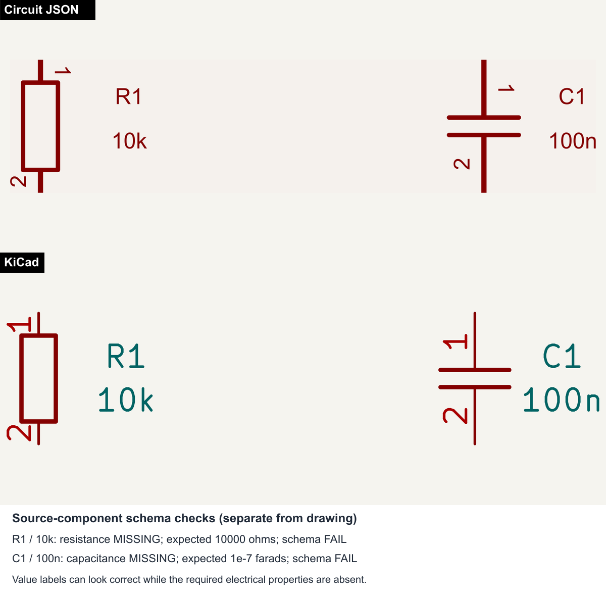
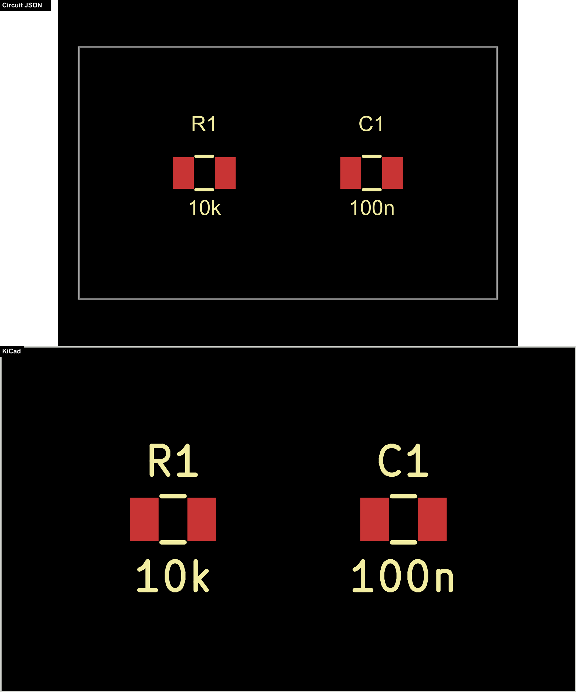

# Missing schematic resistance and capacitance

This self-contained schematic places two components with embedded library
symbols: R1 has `Value = 10k`, and C1 has `Value = 100n`. It needs no external
symbol libraries or schematic wires to reproduce the problem. A companion PCB
places the same two components and provides the PCB snapshot and a positive
control for value conversion.

Run from the repository root with KiCad 10's `kicad-cli` on `PATH`:

```sh
bun test tests/repros/schematic-passive-values/schematic-passive-values.test.ts
```

The schematic snapshot compares the actual imported Circuit JSON (top) with
native KiCad (bottom), using the existing schematic repro rendering and PNG
matcher helpers. The source schematic is converted on its own, and the complete
output JSON and SVG are saved alongside the PNG. Both drawings retain the value
labels. A separate panel below them reports field presence and schema-validation
results directly from the imported source components, making the missing
electrical properties explicit without altering either drawing.



The PCB test follows the existing repro snapshot workflow: `takeKicadSnapshot`,
`takeCircuitJsonSnapshot`, `stackCircuitJsonKicadPngs`, and `toMatchPngSnapshot`.
The committed PNG compares Circuit JSON (top) with KiCad (bottom), and the
converted PCB JSON and SVG are saved alongside it. The PCB is converted
separately and verifies that its source components retain valid electrical
values. The missing properties occur in the schematic import and are proven by
the schema assertions below; they do not change the PCB geometry.



To regenerate the snapshots after reviewing a change:

```sh
BUN_UPDATE_SNAPSHOTS=1 bun test -u tests/repros/schematic-passive-values/schematic-passive-values.test.ts
```

The schema test verifies that `kicadts` reads both values and that conversion
creates both components and all four schematic pins. Its snapshot records the
actual source components and validation issues from this repository's
`circuit-json` dependency:

| Instance   | Expected Circuit JSON property | Actual result                                            |
| ---------- | ------------------------------ | -------------------------------------------------------- |
| R1, `10k`  | `resistance: 10000` (ohms)     | `resistance` is absent; the resistor schema rejects it   |
| C1, `100n` | `capacitance: 1e-7` (farads)   | `capacitance` is absent; the capacitor schema rejects it |

The converter instead puts `10k` and `100n` in `manufacturer_part_number`.
`CollectLibrarySymbolsStage.processSymbol()` chooses the correct passive
`ftype`, but only inserts `name`, `ftype`, and `manufacturer_part_number`.
Neither required electrical property is added before returning the output.

Two `test.failing` cases state the desired schema-valid numeric values. They
are expected failures while the bug exists, so this repro can land without
breaking the test suite. An unexpected pass signals that the failure marker
needs removal. To see ordinary red regression tests, temporarily replace
`test.failing` with `test` in this file and rerun the same command.

When implementing the follow-up fix, remove both `.failing` markers and update
the snapshot after checking that the actual output contains the numeric values.
This change only adds the reproduction; it does not modify conversion behavior.
